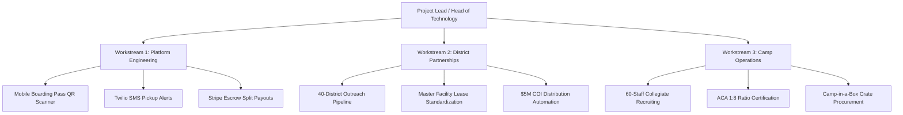

# CampNexus — Pop-Up Summer Camp Operating System

> **Turnkey Operational Platform for Operating Multi-Sport, Theater, and Robotics Day Camps on Underutilized School Campuses.**
> *Topic 86: Pop-Up Summer Camp Operator*

[](https://vercel.com/new/clone?repository-url=https%3A%2F%2Fgithub.com%2FSiddarth021%2Fricoz-innovation)
[](https://github.com/Siddarth021/ricoz-innovation)
[](https://www.typescriptlang.org/)
[](https://nextjs.org/)
[](https://opensource.org/licenses/MIT)

---

## 🚀 Key Project Links & Deliverables

| Deliverable | Description | Link |
| :--- | :--- | :--- |
| **Live Deployed Application** | Production Next.js web application deployed on Vercel | [ricoz-innovation.vercel.app](https://ricoz-innovation.vercel.app) |
| **GitHub Source Code** | Complete full-stack codebase, components, data models, and scripts | [github.com/Siddarth021/ricoz-innovation](https://github.com/Siddarth021/ricoz-innovation.git) |
| **12-Page Business Pitch Deck (PDF)** | Executive 16:9 widescreen presentation deck compiled via LaTeX/Beamer | [`CampNexus_12_Page_Business_Deck.pdf`](./public/CampNexus_12_Page_Business_Deck.pdf) |
| **8-Page Technical PRD Report (PDF)** | Formal technical specification and unit economics feasibility study | [`CampNexus_PRD_Technical_Report.pdf`](./public/CampNexus_PRD_Technical_Report.pdf) |
| **Interactive In-App Slide Deck** | 12-slide interactive presentation viewer built directly into the web platform | Access via the **"12-Page Deck"** navigation tab in the app |

---

## 1. Overview & Vision

**CampNexus** is an asset-light operational platform designed to lease underutilized K-12 school campuses during summer downtime (June through August) and operate high-density, multi-track summer day camps.

Public and private school campuses represent billions in municipal capital investment—boasting air-conditioned gymnasiums, 350+ seat auditoriums, athletic fields, and high-speed computer labs that sit dark for 10–12 weeks every year. CampNexus monetizes this idle capacity by running three simultaneous enrichment tracks under one neighborhood campus roof:

1. **Multi-Sport Athletic Academy** ($425/week): Soccer, 3v3 Basketball, Flag Football, Agility Drills, Friday Olympic Games.
2. **Creative Arts & Musical Theater Workshop** ($460/week): Stage Acting, Improv, Vocal Coaching, Friday Broadway Gala Showcase.
3. **Robotics, AI & Applied STEM Labs** ($495/week): LEGO Spike Prime, BBC Micro:bit Sensors, Autonomous Rovers, Friday Sumo Bot Arena.

---

## 2. Core Value Propositions

- **For Schools:** Yields **$35,000 to $75,000** in net auxiliary revenue during summer downtime with **zero administrative overhead**, full indemnification (**$5,000,000 liability policy**), dedicated evening custodial crews, and donated equity scholarships for district students.
- **For Parents:** Delivers high-quality neighborhood day camps at **$425–$495/week**, an automated **15% sibling discount**, early/extended care (7:30 AM–6:00 PM), and digital peace of mind with a rolling **4-digit guardian pickup PIN**.
- **For Operators:** Replaces paper clipboards with a digital command center featuring **real-time counselor-to-camper ratio monitors (1:8)**, high-visibility allergy/EpiPen alerts, and serialized **Camp-in-a-Box** equipment dispatch.

---

## 3. 12-Page Business Pitch Deck Structure

The strategic pitch deck (`public/CampNexus_12_Page_Business_Deck.pdf`) and the in-app interactive slide viewer cover:

1. **Slide 1: Executive Title & Vision** — Unlocking Underutilized K-12 School Campuses for Summer Day Camps.
2. **Slide 2: Problem & Market Inefficiency** — 100k+ dark summer campuses, $3k+ working parent summer childcare crisis, and academic "summer slide".
3. **Slide 3: The CampNexus Solution** — Turnkey Pop-Up Operator: Zero Fixed Capex, 48-Hour Camp-in-a-Box Mobilization.
4. **Slide 4: Market Opportunity & TAM / SAM / SOM** — $4.2B US Day Camp TAM, $1.12B SAM, and $48M 5-year SOM.
5. **Slide 5: Multi-Track Curriculum Architecture** — Standardized 5-day syllabi across Multi-Sport, Theater, and Robotics.
6. **Slide 6: Dual-Sided Software Platform** — Next.js 14 parent discovery, school partner facility hub, and real-time operations command.
7. **Slide 7: Operations, Logistics & Trust** — 48-hour staging, strict 1:8 supervision ratios, and two-factor pickup PIN authentication.
8. **Slide 8: Unit Economics & Campus P&L** — $441.6k gross campus revenue, 39.3% EBITDA margin, break-even at 41 campers/week.
9. **Slide 9: Competitive Matrix & Defensive Moats** — Comparison against Camp Galileo, Steve & Kate's, KidzToPros, and iD Tech.
10. **Slide 10: Go-To-Market & Growth Flywheel** — B2B superintendent outreach, Peachjar digital flyers, and 92% district renewal rate.
11. **Slide 11: 3-Year Financial Model & Scaling** — Scaling from 4 to 45 campuses ($1.76M to $19.87M gross revenue).
12. **Slide 12: Leadership, Teammate Workstreams & Execution Roadmap** — Operational roles and sprint tasks for incoming teammates.

---

## 4. Teammate Workstreams & Execution Roadmap

For incoming teammates assigned to Topic 86, the project is organized into three parallel execution workstreams:



### Workstream 1: Platform & Technology Engineering
- **Owner Focus:** Front-end UX, API routes, mobile viewports, automated alerts.
- **Sprint Tasks:**
  - Build PWA offline capabilities for campus director check-in iPads.
  - Implement Twilio SMS notifications triggered upon child scan-in and scan-out.
  - Integrate Stripe Connect escrow splits for automated school district royalty payouts.

### Workstream 2: District Partnerships & Real Estate
- **Owner Focus:** School board relations, superintendent proposals, facility compliance.
- **Sprint Tasks:**
  - Standardize Master Facility Lease contracts and custodial indemnification binders.
  - Expand B2B pipeline across 40 target public and charter school districts.
  - Coordinate school board public agenda items and district insurance reviews.

### Workstream 3: Camp Operations & Staff Recruitment
- **Owner Focus:** Staff hiring, safety compliance, hardware logistics.
- **Sprint Tasks:**
  - Recruit 60 collegiate athletes, drama teachers, and engineering students.
  - Roll out FBI LiveScan criminal background check pipeline and mandatory CPR/AED certification.
  - Procure and assemble serialized Camp-in-a-Box flight crates (7 containers per campus).

---

## 5. Technology Stack

- **Framework:** Next.js 14 (App Router)
- **Language:** TypeScript 5.5
- **Styling:** Tailwind CSS (Custom Editorial & Vibrant Track Themes)
- **Icons:** Lucide React
- **Document Compilers:** pdfTeX / MiKTeX / LaTeX (Beamer 16:9 Presentation & Formal PRD Report)
- **Deployment:** Vercel

---

## 6. Getting Started Locally

### Prerequisites
- Node.js 18.17+ or 20+
- npm or yarn

### Installation
```bash
# Clone the repository
git clone https://github.com/Siddarth021/ricoz-innovation.git
cd ricoz-innovation

# Install dependencies
npm install

# Run the development server
npm run dev

# Build for production
npm run build
```

Open [http://localhost:3000](http://localhost:3000) to view the live platform and pitch deck.

---

## 7. Recompiling PDF Reports & Decks

To recompile the formal LaTeX documents locally:

```bash
# Recompile 12-Page Business Pitch Deck (PDF)
cd deck
pdflatex -interaction=nonstopmode CampNexus_12_Page_Business_Deck.tex

# Recompile 8-Page Technical PRD Report (PDF)
cd ../report
pdflatex -interaction=nonstopmode main.tex
```

---

&copy; 2026 CampNexus Platform Architecture. All rights reserved.
